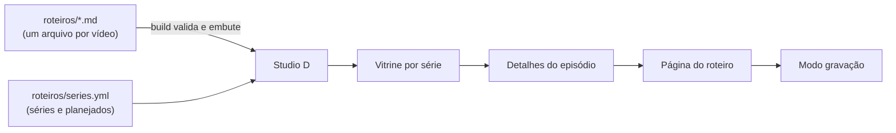

# Studio D

**Os roteiros dos meus vídeos, prontos para gravar.** Cada vídeo do canal ensina como fiz um projeto do meu GitHub: o problema, as decisões, o que deu errado e como melhorar. O Studio D junta esses roteiros numa vitrine com cara de serviço de streaming. Ao abrir um episódio, você vê o roteiro em blocos e, no modo gravação, um teleprompter.

> **Site:** <https://douglasabnovato.github.io/studio-d/> · publicado pelo GitHub Actions a cada merge na `main`.

## Para quem é

- **Para mim, na hora de gravar:** o que dizer, o que mostrar e quanto tempo falta, sem ler texto corrido para a câmera.
- **Para mim, ao planejar:** as séries lado a lado, com o que está planejado, em rascunho, pronto, gravado ou publicado.
- **Para quem assiste:** a página de cada roteiro é pública, com a fonte de cada afirmação.

A hipótese, as métricas e o roadmap estão na [visão do produto](docs/produto/visao.md).

## Como funciona



1. **Abertura:** a letra D desenhada em luz azul, em 2,4 s, uma vez por sessão. Dá para pular com o botão ou com Esc. Com movimento reduzido, o D aparece parado ([ADR-004](docs/adr/004-movimento-e-abertura.md)).
2. **Vitrine:** o roteiro em destaque, uma fileira por série e busca. As setas ← → andam pela fileira.
3. **Detalhes:** objetivo, público, pré-requisitos, fontes e os episódios da série. Esc fecha.
4. **Roteiro:** blocos com tempo (**Fala**, **Tela** e **Comandos**), as fontes e o texto do YouTube (descrição, capítulos e tags), com botão de copiar.
5. **Gravação:** primeiro um checklist de segurança, depois o teleprompter.

| Tecla | No teleprompter |
|---|---|
| Espaço | rolar ou pausar |
| ↑ ↓ | mais rápido ou mais devagar |
| ← → | bloco anterior ou próximo |
| + − | letra maior ou menor |
| Esc | sair |

## Episódios

São 13 roteiros escritos, todos em **rascunho**: cada um espera a revisão do autor antes de gravar ([#10](https://github.com/douglasabnovato/studio-d/issues/10) para o Movies e [#54](https://github.com/douglasabnovato/studio-d/issues/54) para os outros).

| Série | Episódios |
|---|---|
| Do curso ao produto | 1. [Movies](roteiros/do-curso-ao-produto/movies-lcp-no-celular.md) · 2. [Proffy](roteiros/do-curso-ao-produto/proffy-fluxo-no-navegador.md) · 3. [AirCnC](roteiros/do-curso-ao-produto/aircnc-tempo-real.md) · 4. [Be The Hero](roteiros/do-curso-ao-produto/be-the-hero-dados-pessoais.md) |
| Os 12 critérios | 1. [Critério 8](roteiros/os-12-criterios/criterio-8-acessibilidade.md) · 2. [Critério 10](roteiros/os-12-criterios/criterio-10-ci-e-principal-protegida.md) · 3. [Critério 12](roteiros/os-12-criterios/criterio-12-documentacao-honesta.md) |
| Engenharia com IA | 1. [Briefs, revisor e permissões](roteiros/engenharia-com-ia/briefs-revisor-e-permissoes.md) · 2. [Seis fases de um projeto novo](roteiros/engenharia-com-ia/seis-fases-projeto-novo.md) |
| Uma tela, seis telas | 1. [Movies na TV](roteiros/uma-tela-seis-telas/movies-na-tv.md) · 2. [Catálogo de açaí no celular](roteiros/uma-tela-seis-telas/catalogo-acai-no-celular.md) |
| PM na prática | 1. [Hipótese com meta](roteiros/pm-na-pratica/hipotese-com-meta.md) · 2. [Painel de Formação](roteiros/pm-na-pratica/painel-formacao-ativacao.md) |

Não há episódio planejado sem roteiro: em [`roteiros/series.yml`](roteiros/series.yml), as 5 séries estão com `planejados: []`.

## Rodar no seu computador

Requer Node 22.18 ou mais novo (o `site:conferir` roda TypeScript direto no Node, e o `@axe-core/playwright` pede 22.12+).

```bash
npm ci
npm run dev        # http://localhost:5173/studio-d/
npm test           # Vitest: leitura dos roteiros, catálogo, contraste, páginas e abertura
npm run build      # gera dist/; para se algum roteiro for inválido
npm run preview    # serve o build em http://localhost:4173/studio-d/
npx playwright install chromium
npm run test:e2e   # Playwright com axe: temas claro e escuro, desktop e celular
npm run site:conferir  # confere que o site publicado é o Studio D (#43)
```

## Escrever um roteiro

1. Copie [`roteiros/_modelo.md`](roteiros/_modelo.md) para `roteiros/<série>/<slug>.md`.
2. Escreva um bloco por `## Nome · início–fim`, com `### Fala`, `### Tela` e `### Comandos`.
3. Ponha a fonte de cada afirmação em `fontes`.
4. Rode `npm test`.

As regras completas estão em [como escrever um roteiro](docs/como-escrever-um-roteiro.md).

## Estrutura

```
roteiros/              um arquivo Markdown por vídeo, séries em series.yml
src/
  components/          Abertura, Capa, Card, Fileira, Detalhes, Markdown, Topo
  pages/               Inicio, RoteiroPagina, Gravacao (checklist e teleprompter)
  lib/                 leitura e validação dos roteiros, catálogo, tema
e2e/                   testes no navegador com Playwright e axe
docs/                  produto, arquitetura, ADRs, processo e critérios
```

## Estado e próximos passos

**Critérios do MVP:** 10 de 12, finalizado. Os 2 que faltam (5 e 10) dependem de configuração do autor. Os alertas do Dependabot foram ligados em 16/11/2026 e mostram 0 abertos (15h03), com `npm audit --omit=dev` sem vulnerabilidades. LCP móvel no site publicado em 16/11/2026: 1,73 s (mediana de 3). Detalhes em [`docs/MVP.md`](docs/MVP.md).

**O que foi feito**
- Site no ar desde 11/11/2026: vitrine, roteiro, modo gravação e abertura (épico [#15](https://github.com/douglasabnovato/studio-d/issues/15), PR [#13](https://github.com/douglasabnovato/studio-d/pull/13)).
- Roteiros lidos no build, com o JS caindo 33% (PR [#28](https://github.com/douglasabnovato/studio-d/pull/28)).
- Mais 12 roteiros, conferidos contra as fontes, nas 5 séries (PRs [#38](https://github.com/douglasabnovato/studio-d/pull/38) a [#42](https://github.com/douglasabnovato/studio-d/pull/42) e [#44](https://github.com/douglasabnovato/studio-d/pull/44) a [#51](https://github.com/douglasabnovato/studio-d/pull/51), na `main` pelo PR [#27](https://github.com/douglasabnovato/studio-d/pull/27)).
- Ciclo de 16/11/2026: conferência semanal do site publicado ([#43](https://github.com/douglasabnovato/studio-d/issues/43)), teste do botão de copiar, LCP medido de novo e o passo a passo da publicação em [`docs/DEPLOY.md`](docs/DEPLOY.md).

**O que queremos fazer**
- Com o autor: proteger a `main` ([#3](https://github.com/douglasabnovato/studio-d/issues/3)), medição de uso ([#4](https://github.com/douglasabnovato/studio-d/issues/4)), revisar os rascunhos ([#10](https://github.com/douglasabnovato/studio-d/issues/10) e [#54](https://github.com/douglasabnovato/studio-d/issues/54)).
- No código: conferir o build publicado ([#55](https://github.com/douglasabnovato/studio-d/issues/55)), pacote menor ([#56](https://github.com/douglasabnovato/studio-d/issues/56)), tema do sistema ([#57](https://github.com/douglasabnovato/studio-d/issues/57)), fontes dos roteiros ([#58](https://github.com/douglasabnovato/studio-d/issues/58)) e LCP a cada deploy ([#59](https://github.com/douglasabnovato/studio-d/issues/59)).

**Onde está a documentação:** o índice em [`docs/README.md`](docs/README.md), o estado em [`docs/MVP.md`](docs/MVP.md), o plano em [`docs/PLANO-DE-ACAO.md`](docs/PLANO-DE-ACAO.md) e a publicação em [`docs/DEPLOY.md`](docs/DEPLOY.md).

## Documentação

| Para saber | Leia |
|---|---|
| Por que o Studio D existe e para onde vai | [Visão do produto](docs/produto/visao.md) |
| Como o código é organizado | [Arquitetura](docs/ARQUITETURA.md) e as [ADRs](docs/README.md#engenharia) |
| Como cada pedido vira issue, PR e entrega | [Como trabalhamos](docs/processo/como-trabalhamos.md) |
| O que está pronto, com evidência | [MVP](docs/MVP.md) |
| Como o site é publicado e conferido | [Publicação](docs/DEPLOY.md) |
| Tudo, num só lugar | [Índice da documentação](docs/README.md) |

A interface é inspirada em serviços de streaming, com identidade própria: nome, cores, desenho e capas são do Studio D ([ADR-001](docs/adr/001-inspiracao-sem-copia.md)).
