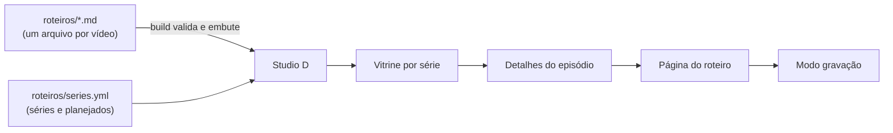

# Studio D

**Os roteiros dos meus vídeos, prontos para gravar.** Cada vídeo do canal ensina como fiz um projeto do meu GitHub: o problema, as decisões, o que deu errado e como melhorar. O Studio D junta esses roteiros numa vitrine com cara de serviço de streaming. Ao abrir um episódio, você vê o roteiro em blocos e, no modo gravação, um teleprompter.

> **Site:** <https://douglasabnovato.github.io/studio-d/> · publicado pelo GitHub Actions a cada merge na `main`.

## Para quem é

- **Para mim, na hora de gravar:** o que dizer, o que mostrar e quanto tempo falta, sem ler texto corrido para a câmera.
- **Para mim, ao planejar:** as séries lado a lado, com o que está planejado, em rascunho, pronto, gravado ou publicado.
- **Para quem assiste:** a página de cada roteiro é pública, com a fonte de cada afirmação.

A hipótese, as métricas e o roadmap estão na [visão do produto](docs/produto/visao.md).

## Como funciona



1. **Abertura:** a letra D desenhada em luz azul, em 2,4 s, uma vez por sessão. Dá para pular com o botão ou com Esc. Com movimento reduzido, o D aparece parado ([ADR-004](docs/adr/004-movimento-e-abertura.md)).
2. **Vitrine:** o roteiro em destaque, uma fileira por série e busca. As setas ← → andam pela fileira.
3. **Detalhes:** objetivo, público, pré-requisitos, fontes e os episódios da série. Esc fecha.
4. **Roteiro:** blocos com tempo (**Fala**, **Tela** e **Comandos**), as fontes e o texto do YouTube (descrição, capítulos e tags), com botão de copiar.
5. **Gravação:** primeiro um checklist de segurança, depois o teleprompter.

| Tecla | No teleprompter |
|---|---|
| Espaço | rolar ou pausar |
| ↑ ↓ | mais rápido ou mais devagar |
| ← → | bloco anterior ou próximo |
| + − | letra maior ou menor |
| Esc | sair |

## Episódios

| Série | Episódio | Situação |
|---|---|---|
| Do curso ao produto | [1. Movies: de 3,3 s para 2,4 s no celular](roteiros/do-curso-ao-produto/movies-lcp-no-celular.md) | Rascunho, revisão do autor ([#10](https://github.com/douglasabnovato/studio-d/issues/10)) |
| Do curso ao produto | 2. Proffy: do curso ao fluxo testado no navegador | Planejado ([#6](https://github.com/douglasabnovato/studio-d/issues/6)) |
| Os 12 critérios | Critério 8: acessibilidade com axe, teclado e tema escuro | Planejado ([#7](https://github.com/douglasabnovato/studio-d/issues/7)) |
| Engenharia com IA | Briefs, revisor independente e permissões | Planejado ([#8](https://github.com/douglasabnovato/studio-d/issues/8)) |

Os outros episódios planejados estão em [`roteiros/series.yml`](roteiros/series.yml).

## Rodar no seu computador

Requer Node 22 ou mais novo.

```bash
npm ci
npm run dev        # http://localhost:5173/studio-d/
npm test           # Vitest: leitura dos roteiros, catálogo, contraste, páginas e abertura
npm run build      # gera dist/; para se algum roteiro for inválido
npm run preview    # serve o build em http://localhost:4173/studio-d/
npx playwright install chromium
npm run test:e2e   # Playwright com axe: temas claro e escuro, desktop e celular
```

## Escrever um roteiro

1. Copie [`roteiros/_modelo.md`](roteiros/_modelo.md) para `roteiros/<série>/<slug>.md`.
2. Escreva um bloco por `## Nome · início–fim`, com `### Fala`, `### Tela` e `### Comandos`.
3. Ponha a fonte de cada afirmação em `fontes`.
4. Rode `npm test`.

As regras completas estão em [como escrever um roteiro](docs/como-escrever-um-roteiro.md).

## Estrutura

```
roteiros/              um arquivo Markdown por vídeo, séries em series.yml
src/
  components/          Abertura, Capa, Card, Fileira, Detalhes, Markdown, Topo
  pages/               Inicio, RoteiroPagina, Gravacao (checklist e teleprompter)
  lib/                 leitura e validação dos roteiros, catálogo, tema
e2e/                   testes no navegador com Playwright e axe
docs/                  produto, arquitetura, ADRs, processo e critérios
```

## Estado e próximos passos

- **Critérios do MVP:** 9 de 12, finalizado. LCP móvel no site: 1,94 s (mediana). Os 3 que faltam dependem de configuração do autor ([`docs/MVP.md`](docs/MVP.md)).
- **No ar desde 11/11/2026:** o épico [#15, Studio D no ar](https://github.com/douglasabnovato/studio-d/issues/15), com o Pages ([#2](https://github.com/douglasabnovato/studio-d/issues/2)), a abertura ([#5](https://github.com/douglasabnovato/studio-d/issues/5)) e a documentação ([#14](https://github.com/douglasabnovato/studio-d/issues/14)). Falta só a `main` protegida ([#3](https://github.com/douglasabnovato/studio-d/issues/3)), que é do autor.
- **Depois:**
  - medição de uso ([#4](https://github.com/douglasabnovato/studio-d/issues/4));
  - pacote menor ([#9](https://github.com/douglasabnovato/studio-d/issues/9));
  - novos roteiros ([#6](https://github.com/douglasabnovato/studio-d/issues/6), [#7](https://github.com/douglasabnovato/studio-d/issues/7) e [#8](https://github.com/douglasabnovato/studio-d/issues/8)).

## Documentação

| Para saber | Leia |
|---|---|
| Por que o Studio D existe e para onde vai | [Visão do produto](docs/produto/visao.md) |
| Como o código é organizado | [Arquitetura](docs/ARQUITETURA.md) e as [ADRs](docs/README.md#engenharia) |
| Como cada pedido vira issue, PR e entrega | [Como trabalhamos](docs/processo/como-trabalhamos.md) |
| O que está pronto, com evidência | [MVP](docs/MVP.md) |
| Tudo, num só lugar | [Índice da documentação](docs/README.md) |

A interface é inspirada em serviços de streaming, com identidade própria: nome, cores, desenho e capas são do Studio D ([ADR-001](docs/adr/001-inspiracao-sem-copia.md)).
