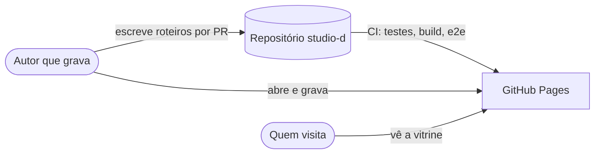
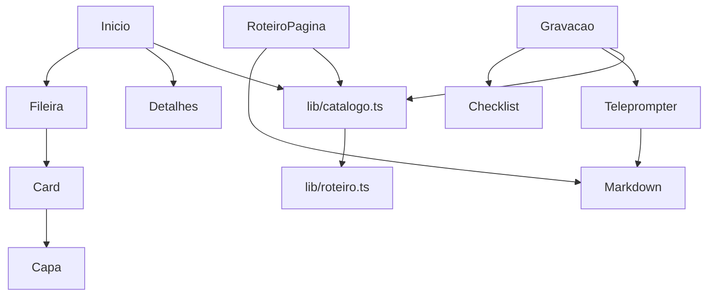

# Arquitetura do Studio D

> Atualizada em 11/11/2026. Descreve o que está no código.

## Contexto (C4, nível 1)

## Contêineres (nível 2)

| Contêiner | Tecnologia | Responsabilidade |
|---|---|---|
| Site | React 19 + Vite + TypeScript, React Router (`HashRouter`) | Vitrine, página do roteiro e modo gravação |
| Conteúdo | Markdown com cabeçalho YAML em `roteiros/` | Um arquivo por vídeo; `series.yml` com séries e planejados |
| CI | GitHub Actions | `verificar` (tipos, testes, build, audit), `e2e` (Playwright + axe) e `publicar` (Pages) |

## Componentes (nível 3)

- `lib/roteiro.ts` lê e valida um arquivo: cabeçalho, blocos `## Nome · início–fim`, `### Fala/Tela/Comandos` e `## Para o YouTube`.
- `lib/catalogo.ts` junta os roteiros com `series.yml`, recusa série inexistente e slug repetido, e monta as fileiras com escritos e planejados.
- `Capa` gera a capa em SVG a partir da série e do título.
- `Detalhes` é uma janela modal: foco preso, Esc fecha, e o foco volta ao card.
- `Teleprompter`: rolagem por `requestAnimationFrame`, bloco atual pela linha de leitura a 30% da altura, atalhos de teclado.

## Decisões

[ADR-001](adr/001-inspiracao-sem-copia.md) inspiração sem cópia de marca · [ADR-002](adr/002-roteiro-em-markdown.md) roteiro em Markdown · [ADR-003](adr/003-site-estatico-sem-dados-pessoais.md) site estático sem dados pessoais · [ADR-004](adr/004-movimento-e-abertura.md) movimento reduzido e abertura.

## Fora do escopo deste ciclo

Abertura animada com o D (fase 4), medição de uso, edição de roteiro pelo site, login.
