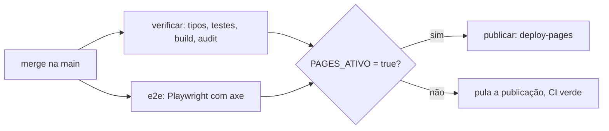

# Publicação no GitHub Pages

O Studio D é um site estático. O GitHub Actions publica o build no Pages a cada merge na `main`. Não há servidor, banco nem segredo.

**Endereço:** <https://douglasabnovato.github.io/studio-d/>

## Como o site chega ao ar

- O workflow é o [`.github/workflows/ci.yml`](../.github/workflows/ci.yml).
- O job `publicar` só roda num push na `main`, depois de `verificar` e `e2e`, e só com a Variable `PAGES_ATIVO` igual a `true`.
- Com a Variable desligada, a `main` fica verde e o site não muda. Isso deixa mesclar com o Pages desligado.
- O build usa `base: '/studio-d/'` ([`vite.config.ts`](../vite.config.ts)). As rotas usam `#`, então o Pages não precisa de página 404 própria.

## Estado em 16/11/2026

- Pages ligado com a fonte "GitHub Actions", e `PAGES_ATIVO=true` (lido por `gh api repos/douglasabnovato/studio-d/actions/variables`).
- Último deploy: commit `611b5e7` (PR #27), em 16/11/2026, pelo run 43799589604.
- O HTML publicado pede `assets/index-NY5LSstr.js`, o mesmo arquivo do `npm run build` local desse commit.

## Ligar do zero (só o responsável)

Passo a passo, se o Pages for desligado ou o repositório for recriado:

1. **Settings → Pages → Build and deployment → Source:** escolher **GitHub Actions**.
2. **Settings → Environments → github-pages → Deployment branches and tags:** deixar só a `main`.
3. **Settings → Secrets and variables → Actions → Variables → New repository variable:** nome `PAGES_ATIVO`, valor `true`.
4. O CI não tem disparo manual: ele roda só em push e em PR. Para publicar, fazer um merge na `main` ou, em **Actions → CI**, abrir o último run da `main` e usar **Re-run all jobs**.
5. Conferir: `curl -s -o /dev/null -w "%{http_code}" https://douglasabnovato.github.io/studio-d/` deve dar `200`, e `npm run site:conferir` deve dizer `OK`.

Nenhum desses passos usa senha ou token.

## Conferência semanal do site (#43)

- O workflow [`.github/workflows/site-no-ar.yml`](../.github/workflows/site-no-ar.yml) roda toda segunda às 12h UTC (9h de Brasília).
- Ele baixa o site e compara com o [`index.html`](../index.html) do repositório: status 200, mesmo `<title>` e mesma `<meta name="description">`. A descrição cita o dono, e por isso um site de terceiro com o mesmo título não passa.
- Em falha, o job fica vermelho na aba Actions. Nada é enviado a terceiros.
- O job também roda em PR que mexe nele (workflow, script ou `src/lib/conferir-site.ts`). Ele compara o site em produção com o `index.html` do PR: um PR que mude o título ou a descrição e toque nesses arquivos fica vermelho até o deploy. Nesse caso, separar a mudança do `index.html` em outro PR.
- Para rodar na mão: `npm run site:conferir`, ou **Actions → Site no ar → Run workflow** (depois que o workflow estiver na `main`).
- O `schedule` só roda na branch padrão. Num repositório público, o GitHub desliga o agendamento depois de 60 dias sem atividade. Se isso acontecer: **Actions → Site no ar → Enable workflow**.

## Se a publicação falhar

| Sintoma | Causa provável | O que fazer |
|---|---|---|
| `publicar` pulado | `PAGES_ATIVO` diferente de `true` | Passo 3 acima (responsável) |
| `publicar` falha em `deploy-pages` com "Branch is not allowed" | O ambiente `github-pages` não aceita a `main` | Passo 2 acima (responsável) |
| `publicar` falha em `configure-pages` | Fonte do Pages não é "GitHub Actions" | Passo 1 acima (responsável) |
| Site responde 200, mas `site:conferir` falha | Build antigo em cache ou outro site no endereço | Esperar alguns minutos e rodar de novo; se seguir, abrir issue com a saída |
