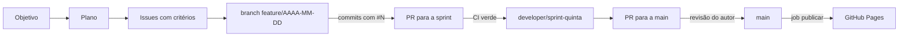

# Como trabalhamos

Do pedido à entrega no ar, todo trabalho passa por uma issue. A base do processo é o repositório [`douglasabnovato/engenharia`](https://github.com/douglasabnovato/engenharia).

## 1. Do objetivo às issues

1. **Entender o objetivo:** o que o autor quer e por quê, em uma frase.
2. **Estudar:** o que o repositório já tem, o que outros produtos fazem e o que os guias oficiais dizem, com fonte.
3. **Planejar:** a seção do ciclo em [`../PLANO-DE-ACAO.md`](../PLANO-DE-ACAO.md).
4. **Quebrar em tarefas:** uma issue por entrega, no modelo abaixo. Trabalho grande vira um **épico** com sub-issues (como o #15).

**Modelo de issue**

| Seção | O que vai |
|---|---|
| Objetivo | O resultado, em uma ou duas frases |
| Motivo | Por que agora, e o que acontece sem isso |
| Critérios de entrega | 3 a 5 caixas verificáveis, cada uma com como conferir |
| Fora desta issue | O que não entra, para a issue não crescer |

Cada issue entra no Project com todos os campos: Status, Prioridade (P0 a P3), Tamanho (XS a XL) e Pontos, Início e Fim, Tipo, Frente, Depende de e Objetivo. Também recebe o marco e o rótulo. Quem só o autor resolve leva `depende-do-responsavel`.

## 2. Do código ao PR

- **Branch:** `feature/AAAA-MM-DD`, nascida da sprint `developer/sprint-<próxima quinta>`.
- **Commits:** pequenos, em português, no padrão `tipo: o quê (#N)`, com push a cada commit. Exemplos: `feat: abertura com a letra D (#5)`, `docs: visão do produto (#14)`.
- **Antes do push:** `npm run lint`, `npm test` e `npm run build`. O build para se um roteiro for inválido.
- **PR para a sprint:** o título cita a issue, e o corpo traz:
  - "Fecha #N" ou "Parte de #N";
  - os critérios da issue marcados;
  - as evidências, com comando, data e resultado;
  - o que revisar.
- **Revisão independente:** um revisor que lê só o diff, antes do merge.

## 3. Da sprint à main

- O merge na sprint acontece só com o CI verde (`verificar` e `e2e`), numa tentativa.
- O PR da sprint para a `main` leva o rótulo `revisao-responsavel` e fica com o autor.
- Com o merge na `main`, o job `publicar` sobe o site no Pages. Ele só roda com a Variable `PAGES_ATIVO` = `true`.
- Depois do merge, cada issue recebe um comentário com a evidência e é fechada.
- O Dependabot junta todas as GitHub Actions num PR só por semana (grupo `actions`). Esse PR vai para a `main` e é revisado pelo autor, que lê as notas das versões maiores antes do merge.

## 4. Pronto quer dizer

- Os critérios de entrega da issue estão marcados, cada um com evidência.
- O CI está verde, e o axe não acusa violações nos dois temas.
- A documentação foi atualizada no mesmo PR: o README, o `docs/MVP.md` e a ADR, se houve decisão.
- O que ficou de fora virou issue nova.
